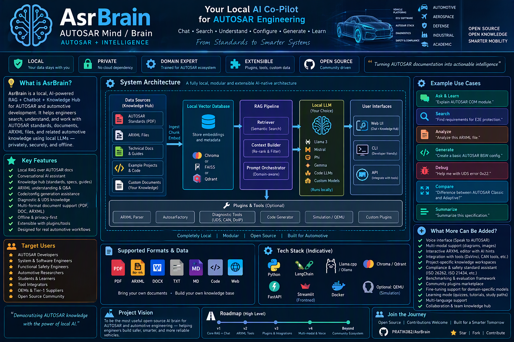

# AUTOSAR Knowledge Copilot

Local-first, citation-grounded RAG for AUTOSAR Classic / Adaptive / Foundation specifications.
Chatbox-style chat UI (no filter forms to fill): the assistant asks back for a missing
release/platform, auto-detects the module with Confirm/Change, and routes document type
automatically. Every factual claim carries a source citation (PDF + pages + requirement IDs).

> **Merged:** `feature/multimodal-rag-chatbox-upgrade` → `main` via true merge
> commit `631778b` (parents: `main` + `875a9d5`; earlier squash `0726bb5`/PR #1
> carried the same content).
> Adds the multimodal RAG stack: canonical multimodal model (`src/schema/canonical.py`,
> `src/schema/multimodal_graph.py`), parser adapters (`src/ingestion/parser_adapter.py`),
> text/table/figure processors (`src/ingestion/processors.py`), query planner
> (`src/retrieval/planner.py`), modality fusion (`src/retrieval/modality_fusion.py`),
> context rules (`src/retrieval/context_rules.py`), generation routing
> (`src/generation/routing.py`), collections (`src/indexing/collections.py`),
> plus audits/migration docs in `docs/` and `tests/unit/test_canonical_multimodal.py`.

## UI view — chatbox at a glance

Streamlit (`apps/streamlit/app.py`, wide layout, dark/light themes) and the React
assistant UI (`frontend/app/page.tsx` → `components/assistant/AssistantShell.tsx`, same
`/api/` SSE contract) share one look:

```
┌─────────────┬───────────────────────────────────────────────────┐
│  Sidebar    │  🚗 AUTOSAR Knowledge Copilot        [Chat|Evidence│
│  ────────   │───────────────────────────────────────────────────│
│ Conversations│  👤 Explain CanIf initialization                  │
│ New/Search/  │  🤖 CanIf init sequence … [E1][E2]                 │
│ Rename/Delete│  📚 Sources (2) ▸ SWS_CanIf.pdf p.12 · 4.4.0 …     │
│ ⑂ Fork      │  Detected: CanIf [✓ Confirm] [Change ▾]             │
│ 💾 Save/Load │  Mode: troubleshooting (auto) · Interpreted as …   │
│ 🤖 Model    │  [Evidence cards] [Trace timeline] [Graph] [👍][👎]  │
│ Ollama/Cloud│─────────────────────────────────────────────────── │
│ Eco/Bal/Deep│  Ask about AUTOSAR… [Send] [⏹ Stop]                 │
│ 📄 Upload   │  follow-ups: payoff chips (3–4, clickable)          │
└─────────────┴───────────────────────────────────────────────────┘
```

| Area | What you see | Source |
|---|---|---|
| Sidebar | Conversation list, search/rename/delete, ⑂ Fork with another model, 💾 Session save/resume (`.json` bundle), provider picker (Local Ollama / Cloud API key, session-only), Evidence depth Eco(4)/Balanced(8)/Deep(12), Response length Concise/Standard/Detailed, 📄 PDF upload + ingest, ⬇ Export `.md` | `apps/streamlit/app.py:145-239` |
| Chat tab | Streaming answer (`token` events + ▌ cursor), staged status (`QueryPlan → retrieval → RRF → rerank → generation`), clarification chips (releases/platforms), module Confirm/Change, `📚 Sources (n)` expander (one line per `[En]`: file · pages · release · section), 👍/👎 feedback, ✏️ Edit & resend, ⏹ Stop | `apps/streamlit/app.py:286-399`, `frontend/app/page.tsx:8-73` |
| Evidence tab | Cited passages `[En]` with PDF + pages + requirement/API IDs | `src/retrieval/modalities.py`, `src/schema/multimodal.py` |
| Trace tab | QueryPlan, routing (doctype auto), per-release retrieval, fusion/rerank, token caps, verification/confidence | `src/workflows/stages.py`, `src/generation/routing.py` |
| Graph tab | Requirement/API/ECUC/table/figure links (multimodal graph) | `src/schema/multimodal_graph.py`, `src/retrieval/graph.py` |

**Screenshots:** none checked in yet (no `*.png` in repo). To add:
1. `streamlit run apps/streamlit/app.py` → ask “Explain CanIf initialization” → screenshot chat + Evidence/Trace tabs.
2. Save to `docs/images/chatbox-chat.png`, `docs/images/chatbox-evidence.png`, `docs/images/chatbox-trace.png`.
3. Reference them here:
   `` etc.

Run the UI:

```bash
streamlit run apps/streamlit/app.py   # self-contained, works without API server
# optional React: cd frontend && npm install && npm run dev   # needs API on :8000
```

### Two UIs — which one am I looking at?

The repository ships **two** front ends over the same `/api/` contract:

| UI | Command | Status |
|---|---|---|
| **Streamlit chatbox** | `streamlit run apps/streamlit/app.py` | **legacy / maintenance mode** — the 7-tab chat, evidence, trace, graph, src, arxml and tokens view |
| **React engineering workspace** | `cd frontend && npm run dev` (needs the API on :8000) | **the product surface** — left module nav, cited thread, answerability badges, evidence drawer, knowledge panel |

The React app is the one being redesigned into the *AsrBrain Engineering Workspace*
(see `docs/architecture/`). If you started the API and Streamlit only, you are looking at
the legacy UI — start the React app to see the workspace.

## Quickstart

```bash
pip install -r requirements.txt
cp .env.example .env            # set LLM_MODEL to an Ollama model you have pulled
python -m src.ingestion.pipeline --pdf-dir pdf --out data/canonical
python -m src.indexing.build --canonical data/canonical/canonical.db
uvicorn apps.api.main:app --port 8000     # terminal 1 (chat API + legacy /query)
streamlit run apps/streamlit/app.py       # terminal 2 — chat UI (works without the API server too)
```

No Ollama running? Answers fall back to extractive, fully-cited passages. Cloud models
(OpenAI GPT, Gemini, Opencode/Cloud…) work via the provider picker + session-only API key.

## Asking questions (no corpus filters)

There is deliberately no release/platform/module sidebar. Flow:

1. Ask naturally, e.g. “Explain CanIf initialization”.
2. If release/platform are missing **and the corpus spans versions**, the assistant asks back
   with one-tap chips (“4.4.0”, “R22-11”, “any release”…).
3. Detected modules are proposed (`Detected: CanIf [✓ Confirm] [Change ▾]`) — the filter
   applies only after you confirm or when you named it yourself.
4. Document type (SWS/PRS/RS/…) is always routed automatically and shown in the trace.

Search mode is automatic too (ChatGPT/Gemini-style): the detected intent is shown as
`Mode: troubleshooting (auto)` with per-mode answer formats (comparison tables, diagnostic
sequences, configuration procedures). The view auto-follows new messages; long source lists
collapse into one `📚 Sources (n)` expander; every answer ends with 3–4 clickable follow-up
questions (grounded in the retrieved APIs/requirements/modules) or just type your own.
Spelling is auto-corrected before retrieval (`can if` → `CanIf`, `configurare` → `configure`;
identifiers, versions, and citations are never rewritten) with an “Interpreted as” note.

## Sessions: no re-loading, models per chat

- **Everything persists**: messages, release/platform/module slots, evidence cards, traces,
  follow-ups, and the model each chat uses — close the app, reopen, and continue. The
  Evidence/Trace/Graph tabs rehydrate from the saved context.
- **Follow-ups reuse context**: the previous exchange travels with the next question, so
  “its message format?” resolves against the prior SOME/IP answer without re-deriving state.
- **Different AI per workstream**: each conversation remembers its provider/model. **⑂ Fork
  with another model** clones the slots into a fresh history — pick another Ollama model or a
  cloud key and start the same topic elsewhere.
- **Portable save files**: sidebar → 💾 Session save/resume exports a `.json` bundle
  (messages + slots + model); import it here or on another machine. Same via
  `GET /api/conversations/{id}/export` + `POST /api/conversations/import`. The index itself
  stays on disk (`data/indexes/`) — sessions never trigger re-ingest.

## Institutional assistant UI (React)

`frontend/` is no longer a skeleton — it is the institutional assistant surface:
a ChatGPT/Copilot/Claude-class shell over the same `/api/` contract.

```
┌──────────────┬────────────────────────────────────────┬───────────────┐
│  Sidebar     │  Scope: mode · provider · release/module │  Knowledge    │
│  surfaces    ├────────────────────────────────────────┤  Corpus stats │
│  conversation│  Thread: answer · confidence · steps ·   │  Concept flow │
│  search      │  sources · follow-ups                    │  Anchors      │
│  rename/del  ├────────────────────────────────────────┤  Guarantees   │
│  disclaimer  │  Composer: ask | diagnose                │               │
└──────────────┴────────────────────────────────────────┴───────────────┘
```

* **Ask** — cited answers, the 10 backend stages shown as a timeline, every source
  expandable (document, page, section, requirement IDs, snippet).
* **Diagnose** — a reported symptom is classified into one of 9 failure families
  (`signal_not_transmitted`, `timeout`, `port_connection`, `state_machine`,
  `initialisation`, `configuration`, `api_mismatch`, `diagnostic`, `general`) and
  returns **likely causes**, **checks to run** and **candidate fixes** — every one of
  them cited to a page of the indexed specification. Fully deterministic: no model
  needed.
* **Knowledge panel** — corpus statistics, the concept flow (module → requirement → API
  with source and page) and the most-referenced requirements/APIs of this project.
* **Starter prompts** — grouped questions templated with the real module and release
  names of the indexed corpus.

New backend package `src/assistant/` (read-only, model-free) plus:

| Endpoint | Purpose |
|---|---|
| `GET /api/assistant/capabilities` | what the assistant knows and can do |
| `GET /api/assistant/overview` | modules, releases, documents, concept flow, entity anchors |
| `GET /api/assistant/prompts` | `{"groups": [...]}` — the starter-prompt library |
| `GET /api/assistant/triage/categories` | `{"categories": [...]}` — the symptom taxonomy |
| `POST /api/assistant/diagnose` | evidence-grounded triage (deterministic without a provider) |

`/api/chat` and `/api/chat/stream` now persist the per-turn evidence in the message
meta, so the source panel survives a reload.

> The React UI had `tailwindcss` in `devDependencies` but no `tailwind.config.js`,
> `postcss.config.js` or `app/globals.css` — every utility class was inert. The
> pipeline is now wired and the design tokens live in `frontend/app/globals.css`.

Design and rationale: `docs/institutional-assistant-ui-plan.md`.

## Engineering workspace (Phase 1)

`docs/architecture/` holds the redesign of AsrBrain into an **evidence-first engineering
intelligence platform** (product: *AsrBrain Engineering Workspace*):

| Document | Content |
|---|---|
| `docs/architecture/current-state.md` | repository map, the four request/data flows, what works, what is missing, 20 technical-debt items, 11 security/safety risks, the incremental-migration rules |
| `docs/architecture/target-architecture.md` | the 9 product modules, the canonical entity model, the provenance rules, the answerability gate, the platform services, the 8 migration rules, P0–P8 phasing |
| `docs/architecture/adr/` | 9 architecture decision records (answerability gates, provenance-first model, SQLite+igrations, typed graph, ARXML-as-structured-data, tool-first policy, graph-store interface, React-is-the-product, local-first routing) |
| `docs/architecture/product-backlog.md` | Phases 1–8 as small, independently testable milestones with "done when" criteria |
| `docs/architecture/phase-1-implementation-plan.md` | the Phase 1 plan **and** the as-built outcome, verification results, API changes, migration/rollback |

**The answer contract.** The assistant does not publish a correctness percentage. Every
answer carries one of four deterministic statuses:

| Status | Meaning |
|---|---|
| `VERIFIED` | a deterministic tool result and an authoritative source agree |
| `EVIDENCE_SUPPORTED` | the cited sources support the answer; no deterministic validation applies |
| `NEEDS_ENGINEER_REVIEW` | partial evidence, ambiguity, conflict or missing context |
| `INSUFFICIENT_EVIDENCE` | not answered — the reply names exactly which artifact or metadata is missing |

The numeric confidence is internal and now appears only inside the collapsed *Audit*
section, labelled as a heuristic rather than a correctness rate.

**Phase 1 shipped** the workspace shell in `frontend/`: left module nav (Chat, Knowledge,
ARXML Explorer, Graph, Requirements, Tests, Diffs & Impact, Diagrams & Reports, Code
Review, Evaluation), an evidence drawer that opens at the exact cited passage, inline
`[E1] p.42` citation chips, the collapsible answer sections, and honest empty states that
say what is missing and which phase delivers it. The API gained two additive routes —
`GET /api/v2/modules` and `GET /api/v2/answerability/{conversation_id}/{message_index}`
(the latter returns **501** until the gate exists in Phase 5, so the UI can never infer a
status from a confidence float). CI now runs `pytest`, `tsc`, `next build` and asserts
that the built stylesheet really contains the design-system classes.

## Architecture

```
pdf/*.pdf → ingestion (parser adapters: Docling-opt → PyMuPDF → pypdf; tables/figures
            captured with captions + structured rows; header/footer strip; req/API/ECUC
            signals; release/platform/doctype detect; per-PDF quality report)
            → canonical.db (documents + chunks + tables + figures, stable text chunk IDs)
            → hybrid index + modality indexes (requirement/API/ECUC/table/figure, exact-first)
            → chat workflow (QueryPlan → clarify-if-missing → per-release retrieval →
              RRF → rerank → parent-expand → compress → staged status/evidence/token events)
            → generation (Ollama local | OpenAI-compatible cloud w/ session API key;
              extractive fallback) → verifier → confidence/abstain
            → FastAPI chat contract (/api/chat, /stream SSE, conversations, documents,
              sources+page preview, feedback, models/releases/modules) + legacy /query
            → Streamlit Chatbox UI (conversations, streaming, chips, evidence/trace/graph
              panels, upload, export) · React skeleton in frontend/ (same contract)
```

Phasing (spec §7): Phase 1 (this repo, default) = SQLite canonical + local hybrid + FastAPI +
Streamlit + Ollama. Phase 2 adds OpenSearch; Phase 3 adds Neo4j/graph + Qdrant mirror
(`src/indexing/qdrant_index.py`, `src/retrieval/graph.py` stubs ready, Docker profiles ready).

## Project layout

| Path | Content |
|---|---|
| `apps/api/main.py` | FastAPI: legacy `/query /ingest /evaluate` + chat contract `/api/conversations /api/chat /api/chat/stream /api/chat/stop /api/documents /api/sources /api/feedback /api/models /api/releases /api/modules` |
| `apps/streamlit/app.py` | Chatbox UI: conversation sidebar (new/search/rename/delete), chat history, streaming, regenerate/edit/stop, clarification chips, citation cards, evidence/trace/graph tabs, upload, export |
| `frontend/` | React/Next.js institutional assistant UI (sidebar · scope bar · cited thread · knowledge panel · ARXML/diff/code workbenches) — same `/api/` contract, SSE streaming, zustand settings — `full` Compose profile |
| `src/ingestion/` | `pipeline.py` (+tables/figures stores), `parsers.py` (Docling/PyMuPDF/pypdf adapters + quality routing), `pdf_extract.py`, `chunking.py`, `metadata.py`, `parser_adapter.py` + `processors.py` (merged multimodal adapters) |
| `src/schema/` | `documents.py`, `queries.py`, `graph.py` (+confidence/is_inferred), `multimodal.py` (MultimodalEvidence), `canonical.py` + `multimodal_graph.py` (merged multimodal model) |
| `src/retrieval/` | `query_understanding.py`, `clarify.py` (slot-fill), `modalities.py` (req/API/ECUC/table/figure), `fusion.py`, `reranking.py`, `context.py`, `pipeline.py`, `graph.py`, `planner.py` + `modality_fusion.py` + `context_rules.py` (merged) |
| `src/generation/` | `providers.py` (Ollama + OpenAI-compat cloud, streaming), `prompts.py` (per-mode formats), `answer.py`, `citations.py`, `verification.py`, `routing.py` (merged multimodal routing) |
| `src/workflows/` | `router.py` (legacy path), `stages.py` (SSE staged events + cancel) |
| `src/assistant/` | `knowledge.py` (corpus manifest, capabilities, project overview, concept flow, starter prompts) + `triage.py` (9-family symptom classification, cited causes/checks/fixes) — read-only and model-free |
| `src/chat/store.py` | Conversations/messages/slots/feedback SQLite |

## Benchmark (measured, 2026-09-29)

`reports/evaluation/validated.json` on the 1-PDF corpus (SOME/IP PRS R24-11, 169 chunks):

```json
{"n": 8, "hit_rate": 1.0, "abstention_rate": 0.5, "mean_claim_support": 0.3611, "p50_latency_s": 36.3}
```

Read it as: in-corpus SOME/IP lookups answered with citations; the 4 CanIf/Classic
comparison items correctly **abstained** (corpus gap — flagged `needs_human_validation`).
No "95% accuracy" is claimed; see `reports/evaluation/comparison.md` and
`docs/failure-analysis.md` for the honest breakdown. Latency is LLM-bound (~35 s/query on a
14 B local model); retrieval itself is <0.5 s.

## Docker

```bash
make docker-minimal    # api + streamlit + qdrant + ollama
make docker-standard   # + postgres + opensearch
make docker-full       # + neo4j + redis + react frontend
```

`RAG_PIPELINE_VERSION=v1|v2` (default v2) selects legacy vs. multimodal chat pipeline.
**Rollback:** set `RAG_PIPELINE_VERSION=v1`, restart api/streamlit — text-only retrieval,
`/query` unchanged; v2 stores (`tables`, `figures`) are ignored, chunk IDs stable so no
re-index is needed either way. Source PDFs are never baked into images.

## Contributing / feedback

UI has 👍 / 🚨 buttons. To add a gold case: append a JSON line to
`data/benchmarks/autosar_benchmark_v1.jsonl` (schema in `src/evaluation/datasets.py`),
then `make eval`. See `docs/operations-guide.md`, `docs/troubleshooting.md`,
`docs/migration-risk-register.md`.
